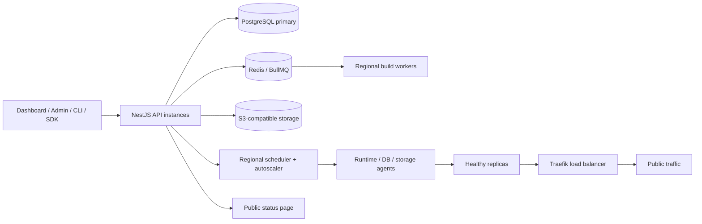

# CloudDeploy Phase 3 architecture

## System overview

CloudDeploy remains a TypeScript monorepo. The Next.js dashboard and super-admin console call a versioned NestJS control plane. PostgreSQL is authoritative, Redis/BullMQ carries background work, MinIO/S3 stores user objects and backups, and Traefik consumes health-filtered routing configuration. The TypeScript SDK and CLI use the same `/api/v1` contract as the web application.

## Phase 3 bounded contexts

- AI: sanitized repository analysis, deployment-log diagnosis, Dockerfile generation, resource sizing, stored analysis history, and review-required fix proposals.
- Marketplace: categorized multi-service templates with databases, Redis, storage, volumes, ports, health checks, environment declarations, domains, and resource estimates.
- Agency: clients, client-project commercial mapping, portal permissions, and white-label branding isolated by organization.
- Regional infrastructure: regions, servers, typed nodes, agent heartbeats, commands, capacity, same-region scheduling, and cross-region dependency warnings.
- Runtime elasticity: policies, cooldown-aware decisions, scaling events, replica reconciliation, and health-only Traefik endpoints.
- Operations: platform admin, support conversations, abuse reports/risk events, public services/incidents, and platform analytics. `apps/runtime-agent` reports real per-container CPU/RAM/process/connection samples on each heartbeat; `detectContainerRisks` (`@clouddeploy/deployment-core`) turns them into deduplicated `RiskEvent` rows for admin review.
- Developer surface: API-key authentication, plan-aware rate limits, IP restrictions, TypeScript SDK, and CLI.
- Security: TOTP 2FA, single-use recovery codes, suspicious-login events, session revocation, secret-access audit schema, SSO and enterprise policy schema.

## Critical invariants

1. Every tenant-owned request is resolved to an organization by `RolesGuard`; platform administration additionally requires `isPlatformAdmin`.
2. Repository files matching secret-bearing paths are discarded. Remaining content is redacted before analysis and raw input is not stored.
3. AI proposals do not mutate resources until an OWNER or ADMIN explicitly applies one. Git repositories are never written by the Dockerfile flow.
4. A scheduler prefers an active node in the project region. Cross-region database or Redis dependencies generate explicit warnings.
5. Only replicas that are `RUNNING` and `healthy` are exported to Traefik.
6. Destructive abuse and server operations create a reviewed action/audit trail; user sessions are revoked on suspension.
7. Agent tokens and API keys are returned once and stored only as SHA-256 hashes. Application secrets remain AES-256-GCM encrypted at rest.
8. Runtime-agents report raw telemetry only; they never decide what counts as abuse. Detection is one deterministic, unit-tested function (`detectContainerRisks`) on the control plane, so the policy is auditable independent of any live container and identical across every node.

## High-availability target

Run multiple stateless API/web instances behind a load balancer; use PostgreSQL with synchronous standby plus WAL archive, Redis Sentinel or a managed HA tier, replicated object storage, multiple build/runtime nodes per active region, and a highly available container registry. The API-key rate limiter is already Redis-backed and shared across instances (`AnyAuthGuard`); other cross-process coordination (locks, leader election for schedulers) still needs the same review before horizontal scaling.

